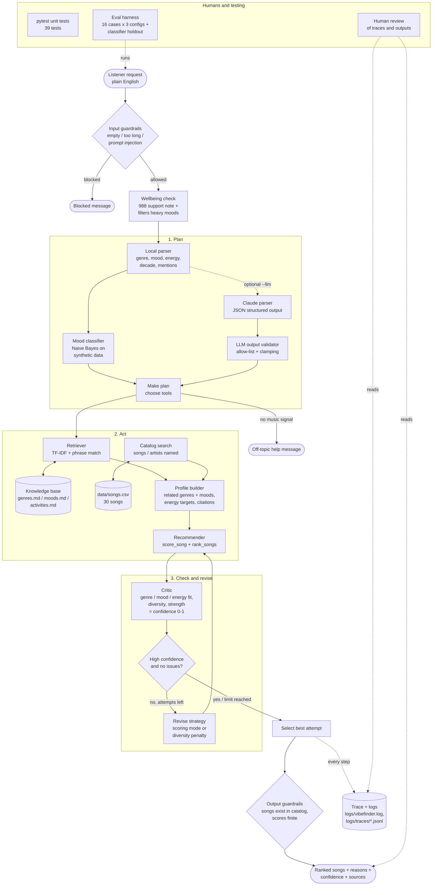

# VibeFinder AI: System Architecture

Source of truth: [architecture.mmd](architecture.mmd). This file has the same diagram in a Mermaid code block, so GitHub renders it.

## How to read it

- **Input guardrails** run before any AI step. Empty, oversized, and prompt-injection requests are blocked. Self-harm language adds a 988 support note and filters out sad, melancholic, and angry songs.
- **Plan:** the local parser extracts preferences. The Naive Bayes mood classifier fills in a mood when none is named. The optional Claude parser's output passes an allow-list validator. The agent then chooses its tools.
- **Act:** the retriever searches the three knowledge files. Catalog search seeds the profile from any named song. The profile builder merges both, with citations, and the recommender ranks the 30-song catalog.
- **Check and revise:** the critic turns fit metrics into a 0-1 confidence score. Until confidence is high and no issues remain, the agent switches scoring mode or turns on the diversity penalty, for up to 3 attempts.
- **Output guardrails** keep only songs that exist in the catalog and have finite scores.
- **Humans and testing:** every step is written to the log and JSONL traces for human review. pytest and the evaluation harness check the system from outside.
